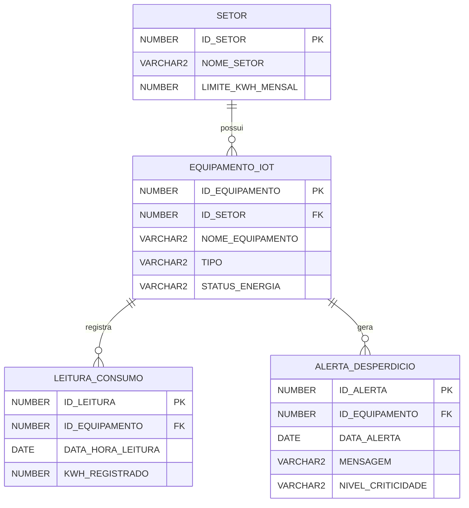

<div align="center">

# ⚡ Automação ESG com PL/SQL

**Banco de dados Oracle que monitora o consumo de energia de equipamentos IoT por setor e gera alertas de desperdício automaticamente com triggers PL/SQL.**


</div>

---

## 📌 Sobre o projeto

Atividade da **FIAP (Análise e Desenvolvimento de Sistemas)** sobre automação de processos ESG.
O objetivo é tirar a fiscalização de consumo de energia das planilhas: as próprias regras de sustentabilidade ficam **dentro do banco**, e cada leitura, falha ou mudança de meta dispara o alerta certo sem depender da aplicação.

## 🗂️ Modelo de dados



## ⚙️ Automações (triggers)

| Trigger | Evento | Regra | Alerta |
|---|---|---|---|
| `TRG_ALERTA_PICO_CONSUMO` | Nova leitura | Consumo acima de **50 kWh** em uma única leitura | 🔴 CRÍTICO |
| `TRG_ALERTA_META_SETOR` | Nova leitura | Leitura maior que **20% do limite mensal** do setor | 🟠 ALTO |
| `TRG_STATUS_FALHA` | Mudança de status | Equipamento passa para `FALHA` ou `DEFEITO` | 🔴 CRÍTICO |
| `TRG_AUDITORIA_META` | Mudança de meta | Limite mensal do setor aumenta **mais de 20%** (governança) | 🟠 ALTO |

Os IDs dos alertas são gerados pela sequence `SEQ_ALERTA`.

## ▶️ Como executar

1. Abra o Oracle SQL Developer (ou outro cliente Oracle).
2. Execute o script [`automacao_esg.sql`](automacao_esg.sql) inteiro (F5): cria tabelas, carrega dados de teste e as triggers.
3. Teste as automações, por exemplo:

```sql
-- dispara pico de consumo (CRÍTICO) e risco à meta do setor (ALTO)
INSERT INTO LEITURA_CONSUMO VALUES (6, 1, SYSDATE, 1200);

-- dispara registro de falha
UPDATE EQUIPAMENTO_IOT SET STATUS_ENERGIA = 'FALHA' WHERE ID_EQUIPAMENTO = 2;

-- dispara auditoria de governança
UPDATE SETOR SET LIMITE_KWH_MENSAL = 2000 WHERE ID_SETOR = 3;

SELECT * FROM ALERTA_DESPERDICIO ORDER BY ID_ALERTA;
```

---

## 👤 Autor

**Christian Santos** — Estudante de Análise e Desenvolvimento de Sistemas na FIAP · Desenvolvedor Back-end & Mobile

[](https://www.linkedin.com/in/christian-santos-6530bb247/)
[](https://christiangit2025-sys.github.io)
